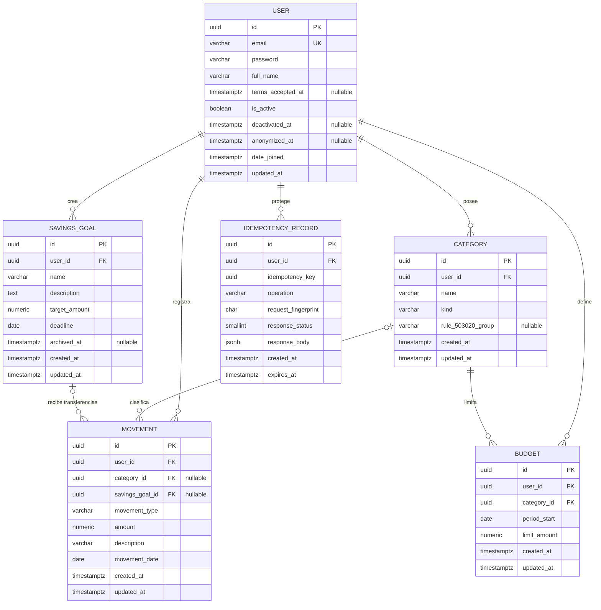

# Diseño de base de datos — FinanzasPro

> Estado: **diseño oficial del MVP, pendiente de implementación**. Este documento
> no implementa modelos Django ni migraciones.
> Base de datos objetivo: **PostgreSQL 15+**, Django 5.x y Django REST Framework.
> Las decisiones de este documento son la referencia canónica para el contrato de
> API y las reglas de negocio.

## 1. Contexto y alcance

El repositorio contiene un frontend React/Vite con los módulos Dashboard, Login,
Registro, Movimientos, Presupuestos, Ahorro y Reportes. El directorio `Backend/`
está vacío: todavía no existe proyecto Django ni migraciones.

Este diseño cubre las cinco entidades solicitadas:

- `User`: usuario propietario de todos los datos financieros.
- `Category`: categoría de ingreso o gasto, siempre perteneciente a un usuario.
- `Movement`: ingreso, gasto o transferencia a una meta de ahorro.
- `Budget`: límite mensual de gasto por categoría.
- `SavingsGoal`: meta de ahorro.

La entidad `Movement` es la **única fuente de verdad** de los movimientos
financieros. Los aportes a metas **no** se guardan en una tabla independiente:
son `Movement` de tipo `savings_transfer` asociados a una `SavingsGoal`.

## 2. Convenciones de diseño

| Tema | Decisión |
| --- | --- |
| Motor | PostgreSQL 15 o superior. |
| Codificación | UTF-8. |
| Zona horaria | `TIME_ZONE = "America/Bogota"`, `USE_TZ = True`; instantes en UTC (`timestamptz`). Las fechas de negocio usan `date` y no se convierten de zona. |
| Claves primarias | `UUID` versión 4 en todas las tablas. Evita IDs enumerables y facilita la exposición pública. |
| Valores monetarios | Django `DecimalField(max_digits=14, decimal_places=2)` → PostgreSQL `NUMERIC(14,2)`, máximo `999.999.999.999,99`. **Nunca** `float`/`double`. |
| Decimales | Todos los importes se guardan con 2 decimales. La API los expone como string decimal. |
| Moneda | COP como única moneda del MVP. No se modela multimoneda ni tipo de cambio. |
| Nombres | Tablas `app_modelo` (convención Django); columnas, modelos y variables del backend en inglés y `snake_case`. Los nombres de categorías y metas son datos de usuario y pueden estar en español. La API también usa nombres en inglés; el frontend traduce mediante una capa de adaptación. |
| Nombres de categorías/metas | Se guardan con `TRIM`; la unicidad es insensible a mayúsculas/minúsculas. |
| Borrado | Los datos financieros históricos no se eliminan en cascada. Se usa `PROTECT`, archivo lógico o baja de cuenta controlada. |
| Auditoría | `created_at` y `updated_at` en las entidades de negocio; `created_at`/`expires_at` en la tabla de idempotencia. |
| Multi-tenencia | Cada fila de negocio tiene `user_id`. Toda consulta se filtra por el usuario autenticado. |

### 2.1 Nombres físicos propuestos

| Entidad | Tabla |
| --- | --- |
| `User` | `users_user` |
| `Category` | `categories_category` |
| `Movement` | `movements_movement` |
| `Budget` | `budgets_budget` |
| `SavingsGoal` | `savings_savingsgoal` |
| `IdempotencyRecord` | `common_idempotencyrecord` |

## 3. Diagrama entidad-relación



### 3.1 Lectura del diagrama

- Un **usuario** posee muchas categorías, movimientos, presupuestos y metas.
- Una **categoría** pertenece a un solo usuario y puede clasificar muchos
  movimientos y presupuestos.
- Un **movimiento** pertenece a un usuario y, según su tipo:
  - ingreso/gasto → exactamente una categoría, sin meta;
  - transferencia a ahorro → exactamente una meta, sin categoría.
- Un **presupuesto** relaciona un usuario, una categoría de gasto y un mes.
  No existe FK directa `Budget → Movement`; el consumo se calcula por
  usuario + categoría + rango mensual.
- Una **meta de ahorro** recibe muchos movimientos de tipo `savings_transfer`.
  El progreso se deriva de esos movimientos y `status`
  (`in_progress`/`completed`/`expired`) se calcula con `target_amount` y
  `deadline`; `archived_at` es un archivo separado. No se guardan como columnas
  duplicadas.
- Un **registro de idempotencia** pertenece a un usuario y garantiza que un
  reintento de una creación financiera no duplique el movimiento. Es una tabla de
  infraestructura, no una entidad financiera.

## 4. Definición de tablas

### 4.1 `User` (`users_user`)

Usuario personalizado basado en `AbstractUser`, sin `username`; el correo es el
identificador de autenticación. Debe existir un `UserManager` personalizado que
normalice el correo antes de guardar.

| Columna | Tipo PostgreSQL | Nulo | Default | Restricciones / notas |
| --- | --- | --- | --- | --- |
| `id` | `uuid` | No | `uuid4()` | PK. |
| `email` | `varchar(254)` | No | — | Login. Formato de correo válido. Único con `LOWER(email)`. Se guarda normalizado. |
| `password` | `varchar(128)` | No | — | Hash administrado por Django; nunca se expone en la API ni se guarda en claro. |
| `full_name` | `varchar(150)` | No | — | Nombre completo mostrado en la UI. `TRIM`, mínimo 2 caracteres. |
| `terms_accepted_at` | `timestamptz` | Sí | `NULL` | Fecha/hora en que el usuario aceptó términos y condiciones. El registro público la exige y la fija el servidor; es `NULL` solo para cuentas creadas por administración. |
| `is_active` | `boolean` | No | `true` | Permite desactivar o anonimizar la cuenta sin borrar la historia financiera. |
| `is_staff` | `boolean` | No | `false` | Acceso al admin. |
| `is_superuser` | `boolean` | No | `false` | Superusuario. |
| `deactivated_at` | `timestamptz` | Sí | `NULL` | Marca la desactivación lógica. No se expone en la API pública. |
| `anonymized_at` | `timestamptz` | Sí | `NULL` | Marca que los datos identificativos fueron anonimizados. No se expone en la API pública. |
| `last_login` | `timestamptz` | Sí | `NULL` | Gestionado por Django. |
| `date_joined` | `timestamptz` | No | `now()` | Fecha de registro. |
| `updated_at` | `timestamptz` | No | `now()` | Se actualiza en cada escritura. |

**Restricciones**

- `UNIQUE INDEX users_user_email_lower_uniq ON users_user (LOWER(email))`.
- `CHECK (char_length(trim(full_name)) >= 2)`.
- `CHECK (email = lower(email))` para mantener la normalización.
- `CHECK (terms_accepted_at IS NOT NULL OR is_staff = true)`: toda cuenta
  pública debe registrar la aceptación; las cuentas administrativas pueden
  existir sin ella.
- `CHECK (anonymized_at IS NULL OR is_active = false)` y
  `CHECK (anonymized_at IS NULL OR deactivated_at IS NOT NULL)`: una cuenta
  anonimizada no puede quedar activa.
- El correo se compara siempre en minúsculas; el registro devuelve `409` si ya existe.

**Índices**

- El índice único funcional sobre `LOWER(email)` es el único necesario para el
  login y la unicidad. No se indexan campos de perfil que no se consultan.

**Decisiones**

- No se usa `username`. El frontend inicia sesión con `email`.
- El cambio de correo queda **fuera del MVP**. No hay endpoint ni verificación
  de correo nuevo en esta versión.
- La aceptación de términos se registra con `terms_accepted_at`; el cliente envía
  `accept_terms: true` y el servidor fija la fecha. No se confía en una fecha
  enviada por el cliente. El versionado de términos es una decisión de
  cumplimiento pendiente (§8).
- La baja de cuenta se detalla en §5.3. No se hace un `DELETE` físico de `User`
  en el MVP: se desactiva o se anonimiza, conservando la fila propietaria de los
  movimientos.

### 4.2 `Category` (`categories_category`)

Catálogo privado de categorías de cada usuario. **Cada usuario recibe
automáticamente las categorías predeterminadas del catálogo de §4.2.1 dentro de
la misma transacción de registro**. No existen categorías globales compartidas.
Las categorías predeterminadas son categorías normales del usuario: pueden
renombrarse, cambiar de grupo 50/30/20 o eliminarse si no están en uso; el sistema
no las recrea después.

| Columna | Tipo PostgreSQL | Nulo | Default | Restricciones / notas |
| --- | --- | --- | --- | --- |
| `id` | `uuid` | No | `uuid4()` | PK. |
| `user_id` | `uuid` | No | — | FK → `users_user.id`, `ON DELETE PROTECT`. Propietario. |
| `name` | `varchar(80)` | No | — | `TRIM`, longitud 2–80. Unicidad insensible a mayúsculas por usuario y tipo. |
| `kind` | `varchar(10)` | No | — | `CHECK IN ('income', 'expense')`. Determina si sirve para ingresos o gastos. |
| `rule_503020_group` | `varchar(10)` | Sí | `NULL` | `CHECK IN ('needs', 'wants')` o `NULL`. Solo aplica a gastos; `NULL` = no clasificada. |
| `created_at` | `timestamptz` | No | `now()` | — |
| `updated_at` | `timestamptz` | No | `now()` | — |

**Restricciones**

- `UNIQUE INDEX categories_user_kind_name_lower_uniq
  ON categories_category (user_id, kind, LOWER(name))`.
- `CHECK (kind IN ('income', 'expense'))`.
- `CHECK (rule_503020_group IS NULL OR rule_503020_group IN ('needs', 'wants'))`.
- `CHECK (kind = 'expense' OR rule_503020_group IS NULL)`: una categoría de
  ingreso no participa en la regla 50/30/20.
- `kind` es **inmutable** una vez creada la categoría. Cambiarla obligaría a
  reinterpretar movimientos y presupuestos históricos.
- `ON DELETE PROTECT` desde `Movement` y `Budget`: no se puede borrar una
  categoría en uso; la API responde `409 resource_in_use`.

**Índices**

- `(user_id, kind)` para poblar selectores de categorías.
- El índice único funcional ya cubre búsquedas por usuario y nombre.

**Eliminación y edición**

- Una categoría usada por un `Movement` o un `Budget` **no se puede eliminar**:
  las FK usan `PROTECT` y la API responde `409 resource_in_use`. Esto conserva el
  historial sin necesidad de una tabla de categorías históricas.
- Renombrar una categoría o cambiar `rule_503020_group` afecta la presentación y
  la clasificación de sus movimientos históricos, porque los reportes leen la
  categoría actual. Es un comportamiento aceptado del MVP; no se guarda una copia
  de la clasificación en cada movimiento.
- `kind` es inmutable. Para corregir un tipo se crea otra categoría y se mueven
  los movimientos, siempre que el tipo siga siendo coherente.

### 4.2.1 Catálogo predeterminado de categorías

Este catálogo se copia para cada usuario al registrarse. Los nombres son datos de
interfaz en español; los campos del backend siguen en inglés.

| `kind` | `name` | `rule_503020_group` |
| --- | --- | --- |
| `income` | Salario | `NULL` |
| `income` | Trabajo independiente | `NULL` |
| `income` | Inversiones | `NULL` |
| `income` | Ventas | `NULL` |
| `income` | Otros ingresos | `NULL` |
| `expense` | Alimentación | `needs` |
| `expense` | Transporte | `needs` |
| `expense` | Vivienda | `needs` |
| `expense` | Servicios | `needs` |
| `expense` | Entretenimiento | `wants` |
| `expense` | Salud | `needs` |
| `expense` | Educación | `needs` |
| `expense` | Otros gastos | `wants` |

La categoría de ahorro de la regla 50/30/20 no se crea aquí: el porcentaje de
ahorro se calcula exclusivamente con `Movement.movement_type =
'savings_transfer'`.

**Regla 50/30/20**

`rule_503020_group` evita depender del nombre de la categoría (el frontend actual
usa un mapa por nombre). Valores:

| Categoría | `rule_503020_group` |
| --- | --- |
| Alimentación, Transporte, Vivienda, Servicios, Salud, Educación | `needs` |
| Entretenimiento, Otros gastos, Compras no esenciales | `wants` |
| Categorías de ingreso | `NULL` |
| Categorías de gasto sin clasificar | `NULL` |

Las categorías de ingreso no pueden tener `rule_503020_group`; la restricción de
base lo impide. La sección **Ahorro** no se toma de una categoría de gasto: se
calcula con los `Movement` de tipo `savings_transfer`.

### 4.3 `Movement` (`movements_movement`)

Registro financiero inmutable en su tipo. Es la fuente de verdad para dashboard,
presupuestos, metas y reportes.

**Canal de creación**

- `income` y `expense` se crean únicamente con `POST /api/v1/movements/`.
- `savings_transfer` se crea únicamente con
  `POST /api/v1/savings-goals/{id}/contributions/`.
- No existe una tabla de aportes: el aporte es un `Movement` de tipo
  `savings_transfer` con `savings_goal_id` obligatorio y `category_id = NULL`.
- La edición y eliminación de cualquier movimiento se hacen por
  `/api/v1/movements/{id}/`, incluidos los aportes ya creados.

| Columna | Tipo PostgreSQL | Nulo | Default | Restricciones / notas |
| --- | --- | --- | --- | --- |
| `id` | `uuid` | No | `uuid4()` | PK. |
| `user_id` | `uuid` | No | — | FK → `users_user.id`, `ON DELETE PROTECT`. Propietario. |
| `category_id` | `uuid` | Sí | `NULL` | FK → `categories_category.id`, `ON DELETE PROTECT`. Obligatoria para ingreso/gasto; `NULL` para transferencia. |
| `savings_goal_id` | `uuid` | Sí | `NULL` | FK → `savings_savingsgoal.id`, `ON DELETE PROTECT`. Obligatoria para transferencia; `NULL` para ingreso/gasto. |
| `movement_type` | `varchar(20)` | No | — | `CHECK IN ('income', 'expense', 'savings_transfer')`. |
| `amount` | `numeric(14,2)` | No | — | `CHECK (amount > 0)`. Django `DecimalField(max_digits=14, decimal_places=2)`. Siempre positivo; el signo se deriva del tipo. |
| `description` | `varchar(255)` | No | — | `TRIM`, mínimo 2 caracteres. Para aportes puede autogenerarse si se omite. |
| `movement_date` | `date` | No | — | Fecha contable usada en presupuestos y reportes. Si se omite, la asigna el servicio con la fecha de negocio en `America/Bogota`; no se usa un `DEFAULT CURRENT_DATE` de PostgreSQL, que dependería de la zona horaria del servidor. |
| `created_at` | `timestamptz` | No | `now()` | Orden de captura. |
| `updated_at` | `timestamptz` | No | `now()` | — |

**Restricción de forma (la más importante)**

```sql
CHECK (
  (
    movement_type IN ('income', 'expense')
    AND category_id IS NOT NULL
    AND savings_goal_id IS NULL
  )
  OR
  (
    movement_type = 'savings_transfer'
    AND category_id IS NULL
    AND savings_goal_id IS NOT NULL
  )
)
```

Esto garantiza a nivel de base de datos que una transferencia a ahorro **no puede**
tener una categoría de gasto. Por tanto, es imposible que entre en un presupuesto
o en el total de gastos por categoría.

**Otras restricciones**

- `CHECK (movement_type IN ('income', 'expense', 'savings_transfer'))`.
- `CHECK (amount > 0 AND amount = ROUND(amount, 2))`.
- La categoría debe pertenecer al mismo usuario que el movimiento y su `kind`
  debe coincidir: `income → income`, `expense → expense`. Esto se valida en el
  servicio y en el serializer; ver §6.2 para el refuerzo opcional en PostgreSQL.
- La meta debe pertenecer al mismo usuario y no estar archivada al crear una
  transferencia.
- `movement_type` es inmutable después de crear el movimiento. Para corregir un
  tipo se elimina y se crea de nuevo; así se evita reinterpretar historia.

**Índices**

| Índice | Uso |
| --- | --- |
| `(user_id, movement_date DESC, created_at DESC)` | Listado y movimientos recientes. |
| `(user_id, movement_type, movement_date)` | Totales de ingresos/gastos/ahorro. |
| `(user_id, category_id, movement_date)` | Gastos por categoría y consumo de presupuesto. |
| `(savings_goal_id, movement_date)` | Historial y progreso de una meta. |
| `(user_id, savings_goal_id)` | Filtro de aportes por meta y usuario. |

**Duplicados e idempotencia**

No se impone unicidad financiera: dos compras iguales el mismo día pueden ser
legítimas. El doble envío por reintento se evita con `Idempotency-Key` en
`POST /movements/` (solo `income`/`expense`) y
`POST /savings-goals/{id}/contributions/` (solo `savings_transfer`); la tabla
`IdempotencyRecord` (§4.6) garantiza una única creación por usuario y clave.
Sin esa clave no se crea un movimiento desde esos endpoints.

### 4.4 `Budget` (`budgets_budget`)

Límite de gasto mensual para una categoría. Solo admite categorías de tipo
`expense`.

| Columna | Tipo PostgreSQL | Nulo | Default | Restricciones / notas |
| --- | --- | --- | --- | --- |
| `id` | `uuid` | No | `uuid4()` | PK. |
| `user_id` | `uuid` | No | — | FK → `users_user.id`, `ON DELETE PROTECT`. Propietario. |
| `category_id` | `uuid` | No | — | FK → `categories_category.id`, `ON DELETE PROTECT`. Debe ser del mismo usuario y `kind='expense'`. |
| `period_start` | `date` | No | — | Primer día del mes. `CHECK (EXTRACT(DAY FROM period_start) = 1)`. |
| `limit_amount` | `numeric(14,2)` | No | — | `CHECK (limit_amount > 0)`. Django `DecimalField(max_digits=14, decimal_places=2)`. |
| `created_at` | `timestamptz` | No | `now()` | — |
| `updated_at` | `timestamptz` | No | `now()` | — |

**Restricciones**

- `UNIQUE (user_id, category_id, period_start)` → evita duplicados del mismo
  presupuesto en el mismo mes. La API responde `409 duplicate_resource`.
- `CHECK (limit_amount > 0)`.
- `CHECK (EXTRACT(DAY FROM period_start) = 1)`.
- El usuario del presupuesto debe coincidir con el usuario de la categoría.
- La categoría debe ser de gasto. Se valida en servicio/serializer.
- La categoría se referencia con `PROTECT`: no se borra una categoría con
  presupuestos.

**Índices**

- `(user_id, period_start)` para cargar el mes completo.
- El único compuesto ya cubre la búsqueda por categoría dentro de un usuario.

**Periodo en la API**

La base guarda `period_start = 2026-11-01`; la API expone `period = "2026-11"`.
No se usa un `varchar` `YYYY-MM` para poder comparar y ordenar con fechas.

### 4.5 `SavingsGoal` (`savings_savingsgoal`)

Meta de ahorro del usuario.

| Columna | Tipo PostgreSQL | Nulo | Default | Restricciones / notas |
| --- | --- | --- | --- | --- |
| `id` | `uuid` | No | `uuid4()` | PK. |
| `user_id` | `uuid` | No | — | FK → `users_user.id`, `ON DELETE PROTECT`. Propietario. |
| `name` | `varchar(100)` | No | — | `TRIM`, 2–100 caracteres. |
| `description` | `text` | Sí | `NULL` | Texto libre; máximo 2000 caracteres. Puede quedar vacío. |
| `target_amount` | `numeric(14,2)` | No | — | `CHECK (target_amount > 0)`. Django `DecimalField(max_digits=14, decimal_places=2)`. |
| `deadline` | `date` | No | — | Fecha límite. Al crear no puede ser anterior a la fecha de negocio actual; al editar se acepta una fecha pasada. |
| `archived_at` | `timestamptz` | Sí | `NULL` | Borrado lógico. `NULL` = meta activa/visible. |
| `created_at` | `timestamptz` | No | `now()` | — |
| `updated_at` | `timestamptz` | No | `now()` | — |

**Restricciones**

- `CHECK (target_amount > 0)`.
- Índice único parcial para evitar metas activas duplicadas:
  ```sql
  CREATE UNIQUE INDEX savings_goal_user_name_lower_active_uniq
  ON savings_savingsgoal (user_id, LOWER(name))
  WHERE archived_at IS NULL;
  ```
  Una meta archivada no bloquea crear otra con el mismo nombre.
- `ON DELETE PROTECT` desde `Movement`: una meta con transferencias no se borra
  físicamente. `DELETE /savings-goals/{id}` la archiva (`archived_at = now()`).
- No tiene columnas `saved_amount`, `remaining_amount`, `progress_percent` ni
  `status`. Se calculan siempre con `SUM(Movement.amount)` y `target_amount` para
  evitar desincronización. `status` usa además `deadline`; `archived_at` no es un
  cuarto estado, solo marca la meta como archivada. `target_amount`, `deadline` y
  `archived_at` son los datos persistidos necesarios.

**Índices**

- `(user_id, archived_at, deadline)` para listar metas activas y vencidas.
- El único parcial anterior.

**Progreso**

```
saved_amount      = SUM(amount) de sus movimientos savings_transfer
remaining_amount  = max(0, target_amount - saved_amount)
progress_percent  = target_amount > 0 ? (saved_amount / target_amount) * 100 : 0
```

Se permite sobreahorro (aportar más allá del objetivo); el porcentaje puede
superar 100. La API devuelve el porcentaje real y la UI puede limitar solo la
representación visual. La meta admite aportes aunque ya esté completada, siempre
que no esté archivada. No existen retiros de ahorro en el MVP.

**Fecha límite**

- Al crear, `deadline` debe ser una fecha válida y no anterior a la fecha de
  negocio actual en `America/Bogota`.
- Al editar, se puede corregir a una fecha pasada; si la meta no está completa,
  el estado calculado pasa a `expired`.
- El estado se evalúa con la fecha de negocio, no con la fecha UTC.

### 4.6 `IdempotencyRecord` (`common_idempotencyrecord`)

Tabla de infraestructura para que los reintentos de creación financiera no
dupliquen movimientos. **El registro se inserta ya completo, en la misma
transacción atómica que el `Movement` y que la respuesta serializada.** No existe
un estado intermedio persistido ni una promesa de respuesta 409 de
«procesamiento en curso».

| Columna | Tipo PostgreSQL | Nulo | Default | Restricciones / notas |
| --- | --- | --- | --- | --- |
| `id` | `uuid` | No | `uuid4()` | PK. |
| `user_id` | `uuid` | No | — | FK → `users_user.id`, `ON DELETE PROTECT`. Aísla las claves por usuario. |
| `idempotency_key` | `uuid` | No | — | Valor del header `Idempotency-Key`, validado como UUID. |
| `operation` | `varchar(40)` | No | — | `CHECK IN ('create_income_expense', 'create_savings_transfer')`. |
| `request_fingerprint` | `char(64)` | No | — | SHA-256 hexadecimal del método, operación, ruta normalizada y cuerpo canónico. |
| `response_status` | `smallint` | No | — | Código HTTP de la respuesta exitosa (`200–299`). |
| `response_body` | `jsonb` | No | — | Respuesta original serializada para reproducirla. |
| `created_at` | `timestamptz` | No | `now()` | Momento de confirmación de la operación. |
| `expires_at` | `timestamptz` | No | — | El servicio lo calcula al insertar como `created_at + IDEMPOTENCY_TTL_HOURS`; PostgreSQL no permite un `DEFAULT` que referencie otra columna. Es purgable después de este instante. |

**Restricciones**

- `UNIQUE (user_id, idempotency_key)`: una clave solo puede identificar una
  creación por usuario. La misma clave de otro usuario es independiente.
- `CHECK (expires_at > created_at)`.
- `CHECK (operation IN ('create_income_expense', 'create_savings_transfer'))`.
- `CHECK (response_status BETWEEN 200 AND 299)`.
- `CHECK (jsonb_typeof(response_body) = 'object')`.
- No se almacenan respuestas de error de validación ni errores 500. Solo se
  persiste una creación confirmada y su respuesta exitosa.
- El registro se elimina al expirar mediante una tarea de limpieza. El cliente
  debe generar una clave nueva por cada acción financiera; no debe reutilizar una
  clave después de 24 horas.

**Índices**

- El único `(user_id, idempotency_key)` cubre la búsqueda de reintentos.
- `(expires_at)` para la limpieza periódica.

**Concurrencia y transacción**

La restricción única es el mecanismo de arbitraje; no se usa una fila intermedia
como bloqueo lógico.

1. La petición abre `transaction.atomic()`.
2. Si ya existe un registro confirmado para `(user_id, idempotency_key)`, compara
   `request_fingerprint`: si coincide, reproduce `response_status` y
   `response_body`; si no coincide, devuelve `409 idempotency_conflict`.
3. Si no existe, crea el `Movement` y serializa la respuesta.
4. Inserta el `IdempotencyRecord` completo y confirma la transacción. El
   movimiento y la respuesta idempotente quedan confirmados o revertidos juntos.
5. Si dos peticiones concurrentes usan la misma clave, PostgreSQL serializa la
   inserción por la restricción única. Una confirma; la otra recibe
   `IntegrityError` al intentar insertar.
6. La petición perdedora debe salir del bloque atómico (rollback), consultar el
   registro ya confirmado en una transacción nueva y reproducir la respuesta. Si
   la operación ganadora revirtió, la inserción de la perdedora no encuentra
   conflicto y la operación puede completarse.

Por tanto, no se devuelve un 409 de «procesamiento en curso»: la segunda petición
espera a que la primera confirme o revierta y, según el resultado, reproduce la
respuesta o ejecuta la operación. La misma clave con otro payload devuelve
`409 idempotency_conflict`. Si la fila no está visible después del rollback, se
reintenta la consulta una vez en una transacción nueva; no se continúa usando la
transacción rota.

## 5. Relaciones y reglas de integridad

| Relación | Cardinalidad | FK / regla | Borrado |
| --- | --- | --- | --- |
| `User → Category` | 1:N | `Category.user_id` | `PROTECT`; baja de cuenta controlada. |
| `User → Movement` | 1:N | `Movement.user_id` | `PROTECT`; baja de cuenta controlada. |
| `User → Budget` | 1:N | `Budget.user_id` | `PROTECT`; baja de cuenta controlada. |
| `User → SavingsGoal` | 1:N | `SavingsGoal.user_id` | `PROTECT`; en operación normal se archiva. |
| `User → IdempotencyRecord` | 1:N | `IdempotencyRecord.user_id` | `PROTECT`; los registros expiran a las 24 h. |
| `Category → Movement` | 1:N | `Movement.category_id`, `PROTECT` | No se borra categoría en uso. |
| `Category → Budget` | 1:N | `Budget.category_id`, `PROTECT` | No se borra categoría con presupuestos. |
| `SavingsGoal → Movement` | 1:N | `Movement.savings_goal_id`, `PROTECT` | La meta se archiva; la historia queda. |
| `Budget ↔ Movement` | — | Sin FK. Se cruzan por `user_id + category_id + mes`. | — |

Las FK hacia `User` usan `PROTECT`, no `CASCADE`: la baja de una cuenta con
historia financiera es un proceso explícito y no un efecto colateral de un
`DELETE`. El MVP no borra físicamente la fila de `User`; la desactiva o la
anonimiza. Si en el futuro se implementa una purga física, el servicio debe
eliminar en orden los registros de idempotencia, movimientos, presupuestos,
metas y categorías dentro de una transacción, y finalmente el usuario. Esa purga
no forma parte del MVP.

### 5.1 Coherencia entre usuarios

La base de datos no puede comparar `Movement.user_id` con `Category.user_id`
mediante una FK simple. La estrategia obligatoria es:

1. Todos los `queryset` se filtran por `request.user`.
2. Al escribir, el servicio recibe el usuario autenticado y obtiene la categoría
   y la meta con `get_object_or_404(Category, id=..., user=request.user)`.
3. Se valida `category.kind` contra `movement_type` y que la meta esté activa.
4. Se prueban casos de acceso cruzado con tests de API.

**Refuerzo opcional a nivel PostgreSQL** (recomendado si se quiere defensa en
profundidad): añadir índices únicos `(id, user_id)` en `categories_category` y
`savings_savingsgoal`, y FKs compuestas `(category_id, user_id)` y
`(savings_goal_id, user_id)`. Django no las genera de forma nativa; requerirían
una migración `RunSQL` o triggers. No son necesarias si el servicio y los tests de
propiedad están bien cubiertos, pero eliminan por completo el riesgo de mezclar
propietarios.

### 5.2 Reglas de duplicados

| Entidad | Regla | Respuesta API |
| --- | --- | --- |
| `User` | Correo único sin distinguir mayúsculas. | `409 duplicate_resource` |
| `Category` | Única por usuario + tipo + nombre normalizado. | `409 duplicate_resource` |
| `Budget` | Único por usuario + categoría + `period_start`. | `409 duplicate_resource` |
| `SavingsGoal` | Nombre único por usuario entre metas activas. | `409 duplicate_resource` |
| `Movement` | Sin unicidad: los movimientos repetidos son válidos. | — |
| `IdempotencyRecord` | Único por usuario + `idempotency_key`. | Replay o `409 idempotency_conflict` |

Los índices únicos son la última defensa. La API debe capturar `IntegrityError`
y traducirlo a `409`, no dejar un error 500.

### 5.3 Baja de cuenta

La cuenta no se elimina físicamente en el MVP. Existen dos procedimientos
controlados:

1. **Desactivación** (`POST /users/me/deactivate/`): exige contraseña actual,
   marca `is_active = false` y `deactivated_at = now()`, revoca todos los refresh
   tokens y conserva todos los datos. La cuenta no puede iniciar sesión. La
   reactivación es administrativa y queda fuera de la API pública.
2. **Eliminación/anonimización** (`DELETE /users/me/`): exige contraseña actual y
   confirmación explícita. Marca `is_active = false`, `deactivated_at = now()` y
   `anonymized_at = now()`, reemplaza `email` por un valor único
   `deleted-{uuid}@example.invalid`, reemplaza `full_name` por `"Usuario
   eliminado"` y revoca los refresh tokens. La fila `User` **permanece**, por lo
   que `Movement.user_id`, `Budget.user_id`, `SavingsGoal.user_id` y
   `Category.user_id` conservan un propietario válido.

En ambos casos se eliminan las cookies de refresh del navegador. La anonimización
no borra movimientos, presupuestos, metas ni categorías: la historia financiera
sigue siendo consultable solo por procesos administrativos y no por el usuario
eliminado. Una purga física futura requerirá una política de retención legal y un
servicio administrativo transaccional; no se implementa en el MVP (§8).

Consecuencia: el correo original queda liberado para un nuevo registro, porque
la fila anonimizada usa un correo reservado único.

## 6. Validaciones y restricciones

### 6.1 Reglas de campo

- Importes: `Decimal`, estrictamente mayores que cero, máximo 14 dígitos totales
  y 2 decimales. No se aceptan `NaN`, `Infinity`, negativos ni notación
  exponencial en la API.
- Descripciones: `TRIM`, entre 2 y 255 caracteres (movimientos); metas 2–100
  caracteres en el nombre y máximo 2000 en `description`.
- Fechas: formato ISO `YYYY-MM-DD`; no se permiten fechas inexistentes ni horas
  en campos `date`. La fecha por defecto se calcula en `America/Bogota`.
- Periodos de presupuesto: `YYYY-MM`, mes entre 01 y 12.
- Metas: objetivo > 0, fecha límite válida; al crear no puede ser anterior a la
  fecha de negocio actual. Una meta activa puede recibir aportes.
- Categoría de movimiento: obligatoria para ingreso/gasto; prohibida para
  transferencia.
- Meta de ahorro: obligatoria para transferencia; prohibida para ingreso/gasto.
- El endpoint `POST /movements/` solo acepta `income` y `expense`; un
  `savings_transfer` en ese payload se rechaza con `400`. La creación de
  transferencias se realiza exclusivamente por
  `POST /savings-goals/{id}/contributions/`.
- Términos: el registro público exige `accept_terms: true`; la fecha se fija en
  el servidor y no se acepta del cliente.
- Idempotencia: `Idempotency-Key` es un UUID válido y obligatorio en
  `POST /movements/` y en `POST /savings-goals/{id}/contributions/`.

### 6.2 Validaciones que cruzan tablas

| Validación | Dónde se aplica |
| --- | --- |
| La categoría pertenece al usuario autenticado. | Servicio + serializer; queries con `user=request.user`. |
| `category.kind` coincide con `movement_type`. | Servicio + serializer. |
| La meta pertenece al usuario autenticado. | Servicio + serializer. |
| La meta no está archivada al aportar. | Servicio. |
| El presupuesto usa una categoría de gasto del mismo usuario. | Servicio + serializer. |
| No se puede borrar una categoría con movimientos/presupuestos. | FK `PROTECT` + captura de `ProtectedError`. |
| No se puede borrar físicamente una meta con aportes. | FK `PROTECT`; se archiva. |
| La clave de idempotencia pertenece al mismo usuario y no se reutiliza con otro payload. | Servicio de idempotencia + `UNIQUE (user_id, idempotency_key)`. |
| La baja de cuenta no deja movimientos huérfanos. | Anonimización de `User`, no `DELETE` físico; FK `PROTECT`. |

## 7. Índices y rendimiento

Los índices propuestos priorizan las consultas reales del frontend:

1. Movimientos del mes y recientes: `(user_id, movement_date DESC, created_at DESC)`.
2. Totales por tipo: `(user_id, movement_type, movement_date)`.
3. Gasto por categoría y presupuesto: `(user_id, category_id, movement_date)`.
4. Aportes por meta: `(savings_goal_id, movement_date)`.
5. Presupuestos del mes: `(user_id, period_start)`.
6. Metas activas: `(user_id, archived_at, deadline)`.
7. Categorías por tipo: `(user_id, kind)`.
8. Idempotencia: único `(user_id, idempotency_key)` y `(expires_at)` para limpieza.

Las agregaciones se ejecutan en PostgreSQL con `SUM`, `GROUP BY` y filtros por
rango `[inicio, fin)`. No se traen todos los movimientos a Python para sumar.

## 8. Decisiones pendientes (no bloqueantes)

El modelo, las relaciones, las reglas financieras y los endpoints del MVP están
definidos. Quedan dos definiciones de cumplimiento que no cambian los cálculos ni
el flujo principal:

1. **Versionado de términos y privacidad.** El MVP registra `terms_accepted_at`,
   pero no la versión aceptada. Si el área legal exige demostrar qué versión se
   aceptó, se añadirán `terms_version` y, si aplica, `privacy_version` a `User` y
   al payload de registro. Consecuencia: cambio de esquema y del contrato de
   registro; no afecta movimientos, presupuestos ni metas.
2. **Retención legal y purga física.** El MVP desactiva o anonimiza la cuenta y
   conserva la historia financiera bajo la fila anonimizada. Si una norma exige
   purgar datos después de un plazo, se necesitará un proceso administrativo
   transaccional que elimine los datos en orden y nunca deje movimientos sin
   propietario. Consecuencia: proceso operativo futuro, fuera de la API pública
   del MVP.
